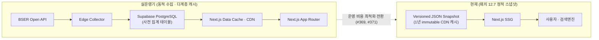

<div align="center">

# ER&GG — 이리와지지

**실사용 지표와 성능 계측을 바탕으로 운영한 이터널리턴 메타 분석 서비스**

[](https://nextjs.org/)
[](https://react.dev/)
[](https://www.typescriptlang.org/)
[](https://nestjs.com/)
[](https://supabase.com/)
[](https://tailwindcss.com/)
[](https://vitest.dev/)

**[서비스 바로가기](https://erwagg.com)** · **[GitHub](https://github.com/BellYun)**

</div>

---

## Overview

ER&GG는 이터널리턴의 패치·티어별 통계를 수집하고, 실험체 성과와 3인 조합 시너지를 비교·분석하는 웹 서비스입니다.

2026년 3월부터 1인 기획·개발·운영을 통해 최고 DAU 1,300을 기록하며 실제 사용자 VOC와 운영 지표를 기반으로 성능을 개선했습니다. 현재는 운영 비용 최적화를 위해 **패치 12.7 기준 정적 스냅샷 아키텍처로 전환**하여 DB·외부 API 의존성 없이 서비스를 유지하고 있습니다.

| 항목      | 내용                                                                 |
| --------- | -------------------------------------------------------------------- |
| 운영 기간 | 2026.03 ~ 2026.11 (현재 패치 12.7 정적 스냅샷 모드 운영)             |
| 개발 형태 | 1인 개발 및 운영 (기획 · UI · Frontend · Backend · DB · 수집 · 배포) |
| 지원 언어 | 한국어 (`/`) · 영어 (`/en`) · 일본어 (`/ja`)                         |

## Key Results

| 영역                 | 성과                                                                   | 측정 기준                                    |
| -------------------- | ---------------------------------------------------------------------- | -------------------------------------------- |
| 서비스 운영          | **최고 DAU 1,300**                                                     | Vercel Analytics                             |
| 모바일 입력 지연     | Input Delay p95 **1,060 → 183ms**, lab INP p95 **1,128 → 216ms (80.9% ↓)** | Playwright (CPU 6x) · Event Timing           |
| 캐시 히트율 개선     | 운영 완전 MISS 비율 **72.5% → 22.4% (50.1%p ↓)**                       | Vercel CDN Cache · Next.js Data Cache        |
| DB 조회 최적화       | 대표 조회 기준 DB row 수 **약 85% ↓**, 평균 응답시간 **약 51% ↓**      | Canonical key 기반 사전 집계 · 조회 인덱스   |
| RSC 직렬화 최적화    | `.next/server/app` **약 6.6GB → 237MB (약 96.5% ↓)**                  | 빌드 산출물 감사 · L10n 청크 분리            |
| 다국어 유입 전환     | 일본어 환경 사용자의 `/ja` 도달률 **23.4% → 60.9%**                    | Middleware rewrite · Locale SEO              |
| 운영 공수 자동화     | 공식 패치 공지 → TypeScript 데이터 변환 및 **자동 PR 파이프라인 구축** | Gemini LLM API · GitHub Actions              |

## Core Features

| 기능                | 설명                                                                     |
| ------------------- | ------------------------------------------------------------------------ |
| **캐릭터 티어표 & 패치 분석** | 패치·티어별 승률, 픽률, 평균 RP와 이전 패치 대비 지표 변화를 한눈에 비교 |
| **캐릭터 상세 분석**          | 무기·장비·특성·스킬 빌드와 추천 조합 통계를 단일 페이지에서 탐색         |
| **3인 조합 분석 & 추천**      | 팀원의 실험체 폭을 기반으로 조합을 추천하고 최소 표본 필터와 소표본 안내 제공 |
| **다국어 & 공유**             | 한국어·영어·일본어 URL 라우팅 및 선택 조건 URL 상태·동적 OG 공유         |

## System Architecture

### 운영기 → 정적 스냅샷 전환 (비용 최적화)

실운영 기간에는 BSER Open API에서 수집한 데이터를 Supabase PostgreSQL에 사전 집계하고, Next.js BFF·Data Cache·CDN·NestJS(Redis)를 조합해 서빙했습니다. ([전환 전 소스](https://github.com/BellYun/ERMeta/tree/affb58f3501689ca9c35cdba34112ae10a34f602))

서비스 축소 단계에서는 실시간 DB 조회와 주기적 ISR 비용을 제거하기 위해 **패치 12.7까지의 통계를 버전드 JSON 스냅샷으로 내보내고, 정적 자산에 1년 `immutable` CDN 캐시를 적용하는 구조**로 전환했습니다. ([정적 전환 PR #371](https://github.com/BellYun/ERMeta/pull/371) · [스냅샷 생성 스크립트](frontend/scripts/export-season-snapshot.py))



### 핵심 설계 원칙 (Design Principles)

- **수집과 조회의 물리적 분리**: 외부 BSER API 호출 및 원본 매치 로그는 Edge Collector와 사전 집계 테이블로 격리하고, 사용자 요청 경로는 사전 집계·캐시·정적 스냅샷만 조회하도록 설계해 DB 스캔 비용과 외부 API Rate Limit 리스크를 차단했습니다.
- **데이터 휘발성 기반 다계층 캐시 & 경계 설계**: 변경 주기에 따라 `1년 immutable 정적 자산`, `Versioned JSON 스냅샷`, `Next.js Data Cache / CDN`, `Redis(L1/L2)`를 분리하고, Server/Client Component 경계에서도 직렬화 비용을 최소화했습니다.
- **순서 무관 Canonical Key 정규화**: 3인 조합 탐색과 캐시 키를 정렬된 canonical key로 표준화해 동일 조합의 중복 집계와 캐시 분산을 방지했습니다.
- **CI 기반 성능·비용 회귀 방어**: E2E, 접근성(`axe-core`), 모바일 INP(CPU 6x), 캐시 수명, PR 아키텍처·비용 감사를 CI 파이프라인에 편입해 품질과 인프라 비용을 구조적으로 통제했습니다.

---

## Engineering Highlights

### 1. 모바일 연속 선택 시 발생한 입력 지연 개선
> 관련 글: [메인 스레드 교통정리하기 (Medium)](https://medium.com/@whd3558/%EB%A9%94%EC%9D%B8-%EC%8A%A4%EB%A0%88%EB%93%9C-%EA%B5%90%ED%86%B5%EC%A0%95%EB%A6%AC%ED%95%98%EA%B8%B0-1de8da9302ad?sharedUserId=whd3558)

- **문제**: 모바일에서 실험체를 연속 터치할 때 반응이 끊긴다는 VOC를 접수하고, Event Timing 분석으로 이전 Long Task가 메인 스레드를 **1,060ms** 점유하던 병목을 식별했습니다.
- **해결**:
  - 선택 UI 상태 반영을 URL 갱신과 분리해 즉각적인 시각 피드백을 제공했습니다.
  - 무거운 결과 렌더링은 `useDeferredValue`로 지연하고, `requestIdleCallback`으로 연산을 분산했습니다.
  - TanStack Virtual과 `ResizeObserver`를 적용해 긴 목록에서 동시 마운트되는 노드 수를 제한했습니다.
- **결과**: Playwright 모바일 환경(CPU 6x) 기준 **Input Delay p95를 1,060 → 183ms**, **lab INP p95를 1,128 → 216ms(80.9% 단축)**로 개선했으며, Nightly CPU 6x 벤치마크(30회 반복 측정)를 구축해 INP 회귀를 상시 추적하고 있습니다.

---

### 2. Vercel CDN Cache · Next.js Data Cache 재사용 경계 및 탐색 구조 개선
> 관련 글: [7일짜리 캐시가 하루 만에 다시 MISS가 난 이유 (Medium)](https://medium.com/@whd3558/7%EC%9D%BC%EC%A7%9C%EB%A6%AC-%EC%BA%90%EC%8B%9C%EA%B0%80-%ED%95%98%EB%A3%A8-%EB%A7%8C%EC%97%90-%EB%8B%A4%EC%8B%9C-miss%EA%B0%80-%EB%82%9C-%EC%9D%B4%EC%9C%A0-9038fe4dcaa2?sharedUserId=whd3558)

- **문제**: CDN Cache와 Data Cache를 분석한 결과, 3인 조합·필터 조건별 요청이 분산되면서 전체 요청의 **72.5%가 완전 MISS**되고 응답에 **약 3.20초**가 소요되는 병목을 확인했습니다.
- **해결**:
  - 조회 API 경계를 세부 조합 단위가 아닌 **공용 후보군 단위**로 재설계하고, 세부 필터링은 브라우저에서 수행하도록 전환했습니다.
  - 조합 파라미터의 튜플 직렬화(canonical key)와 동일 요청 간 Promise 공유를 적용해 중복 계산과 캐시 분산을 제거했습니다.
- **결과**: 기존 조회와의 데이터 정합성 및 클라이언트 렌더링 비용을 검증한 뒤 반영해, 운영 환경의 **완전 MISS 비율을 72.5%에서 22.4%로 50.1%p 감소**시켰습니다.

---

### 3. 일본 사용자 진입을 위한 locale 기반 라우팅 및 SEO 구조 설계
> 관련 글: [일본 사용자 유입을 실제 사용으로 연결하기 위한 다국어 SEO 개선기 (Medium)](https://medium.com/@whd3558/%EC%9D%BC%EB%B3%B8-%EC%82%AC%EC%9A%A9%EC%9E%90-%EC%9C%A0%EC%9E%85%EC%9D%84-%EC%8B%A4%EC%A0%9C-%EC%82%AC%EC%9A%A9%EC%9C%BC%EB%A1%9C-%EC%97%B0%EA%B2%B0%ED%95%98%EA%B8%B0-%EC%9C%84%ED%95%9C-%EB%8B%A4%EA%B5%AD%EC%96%B4-seo-%EA%B0%9C%EC%84%A0%EA%B8%B0-468a345f6f7e)

- **문제**: 언어별 고유 URL이 없어 일본어 콘텐츠를 검색엔진에 독립 색인하거나 공유·딥링크로 전달하기 어려웠고, 일본 유입 사용자가 핵심 기능 사용으로 이어지지 못했습니다.
- **해결**:
  - 기존 한국어 URL 호환성을 깨지 않기 위해 Next.js middleware `rewrite` 기반의 `/ja` 라우팅을 도입했습니다.
  - URL을 최우선 언어 결정 기준으로 삼고, 페이지별 `self-canonical`, `hreflang`, 다국어 `sitemap`을 구성했습니다.
- **결과**: 일본어 환경 사용자의 **`/ja` 도달률을 23.4%에서 60.9%로 개선**했습니다.

---

### 4. LLM API와 GitHub Actions 기반 패치 데이터 자동 파싱 파이프라인 구축
> 관련 PR: [패치 데이터 자동 파싱 파이프라인 PR #364](https://github.com/BellYun/ERMeta/pull/364)

- **문제**: 공식 패치 공지를 서비스용 TypeScript 데이터 파일로 수작업 변환하면서 반복 공수와 휴먼 에러가 발생했습니다.
- **해결**:
  - Gemini LLM API로 패치 노트 본문을 구조화해 버전별 TypeScript 데이터 파일을 자동 생성하는 파싱 스크립트를 작성했습니다.
  - GitHub Actions에서 패치 URL 입력 시 파싱 실행 → `npm test` 정합성 검증 → 자동 PR 생성까지 이어지는 파이프라인을 구축했습니다.
- **결과**: 매 패치마다 반복되던 수동 데이터 변환 운영 공수를 제거했습니다.

---

### 5. 3인 조합 탐색의 응답 지연을 줄이기 위한 사전 집계 구조 도입

- **문제**: 여러 3인 조합을 비교할 때 요청마다 원본 매치 로그를 전수 집계해, 데이터가 누적될수록 조회 row 수와 응답 지연이 커졌습니다.
- **해결**:
  - 세 실험체의 순서를 정렬한 canonical key 기준으로 조합을 1회만 사전 집계하고, 단일·페어·트리오 조회 패턴에 맞는 테이블과 인덱스를 설계했습니다.
- **결과**: 대표 조회 기준 **DB 조회 row 수를 약 85%**, **평균 응답시간을 약 51% 단축**했습니다.

---

### 6. 광고 슬롯별 실제 가시율 계측 및 배치 A/B 실험

- **문제**: 광고 슬롯 로드 횟수만으로는 실제 화면 노출 여부를 알기 어려웠고, 광고 배치가 핵심 콘텐츠 이용에 미치는 영향도 정량적으로 판단하기 어려웠습니다.
- **해결**:
  - 광고가 채워진 뒤 영역의 **50% 이상이 뷰포트에 1초 이상 연속**으로 들어온 경우를 가시 노출로 정의해 슬롯별 실제 가시율과 이탈 시점을 계측했습니다.
  - 홈 광고를 패치 예상 콘텐츠 앞·뒤에 배치하는 A/B 실험을 구현하고, 브라우저에 배정 결과를 고정 저장해 재방문 시에도 동일 실험군을 유지하도록 했습니다.
- **결과**: 10일간(8/28~9/6) 실측 결과 본문 광고 가시율은 **71.7%**, 좌우 사이드 광고는 **94%대**였으며, AdSense Active View에서도 동일한 순서를 확인했습니다.

| 광고 슬롯     | 브라우저 실측 가시율 | AdSense Active View |
| ------------- | -------------------- | ------------------- |
| 콘텐츠 본문   | 71.7%                | 64.83%              |
| 왼쪽 사이드   | 94.3%                | 90.21%              |
| 오른쪽 사이드 | 94.8%                | 90.79%              |

---

### 7. Next.js RSC Payload 및 다국어 사전 직렬화 경계 최적화
> 관련 기록: [Next.js RSC 다국어 사전 직렬화 개선 회고](blog-l10n-rsc-payload.md)

- **문제**: 전역 `L10nProvider`(Client Component)에 언어별 3.3~3.9MB 게임 사전을 통째로 전달하면서, 모든 정적 HTML과 RSC payload에 전체 사전이 중복 직렬화되었습니다. (빌드 감사 기준 `.next/server/app` 약 6.6GB, 전체 `.next` 약 8.3GB)
- **해결**:
  - 초기 렌더링에 필요한 **322개 core key만 12~14KB seed**로 전달해 첫 화면 깜빡임을 방지했습니다.
  - 나머지 번역 데이터는 **기능별 내용 해시(content-hash) 정적 JSON 청크**와 TypeScript manifest로 분리해 필요한 기능에서만 지연 로드하도록 경계를 재설계하고, 네트워크 요청 검증 회귀 테스트를 추가했습니다.
- **결과**: 빌드 감사 기준 `.next/server/app`을 **약 6.6GB → 237MB(약 96.5% ↓)**, 전체 `.next`를 **약 8.3GB → 927MB(약 89.1% ↓)**로 축소하고, 사전과 무관한 페이지 HTML에서 수 MB 규모의 직렬화 데이터를 제거했습니다.

---

<details>
<summary><strong>아카이브: 외부 API 호출 제한을 고려한 플레이어 전적·통계 API 설계 (미배포)</strong></summary>

- BSER Open API 호출 한도를 고려해 동일 프로세스 내 중복 닉네임·갱신 요청을 coalescing하고, 호출 큐 크기와 대기 시간을 제한했습니다.
- 갱신 실패 시 저장된 데이터와 `isStale` 상태를 반환하며, 멀티서치는 플레이어별 부분 성공·실패를 분리 응답하도록 설계했습니다. (구현 및 Cloud Run 배포 구성 완료 후, 외부 API 쿼터 및 서비스 축소 결정에 따라 프로덕션 배포는 보류했습니다. — [백엔드 실행·계약 문서](backend/README.md))

</details>

---

## CI Quality & Performance Gates

단순 린트·단위 테스트를 넘어, 프로덕션 성능·접근성·아키텍처 비용 회귀를 GitHub Actions 파이프라인으로 자동 검증합니다.

| 워크플로우 | 검증 대상 및 역할 | 설정 |
| --- | --- | --- |
| **Frontend PR CI** | ESLint, Vitest, Playwright E2E(`axe-core` 접근성 포함) 및 캐릭터 페이지 캐시 수명 검증 | [e2e-ci.yml](.github/workflows/e2e-ci.yml) |
| **Nightly Mobile Interaction** | Playwright CPU 6x 환경에서 30회 반복 측정으로 모바일 INP 회귀 추적 | [perf-ci.yml](.github/workflows/perf-ci.yml) |
| **PR Architecture & Cost Auditor** | PR 변경분 대상 Gemini 기반 아키텍처·인프라 비용 자동 감사 | [pr-architecture-auditor.yml](.github/workflows/pr-architecture-auditor.yml) |
| **Patch Data Automation** | 패치 URL 입력 → Gemini LLM 파싱 → `npm test` 검증 → 자동 PR 생성 | [generate-patch-notes.yml](.github/workflows/generate-patch-notes.yml) |

---

## Tech Stack

| 영역              | 기술                                                               |
| ----------------- | ------------------------------------------------------------------ |
| **Frontend**      | Next.js 16.2, React 19.2, TypeScript 5, Tailwind CSS v4, next-intl |
| **Backend & Data**| NestJS 11, Supabase PostgreSQL, Redis, BSER Open API               |
| **Testing & Perf**| Vitest, Playwright, axe-core, Web Vitals, Vercel Analytics, Sentry |
| **Automation**    | GitHub Actions, Gemini LLM API                                     |

## Repository Structure

```text
ERMeta/
├── frontend/                  # Next.js App Router, BFF, 정적 스냅샷, E2E/성능 테스트
│   ├── src/app/(site)/[locale]/  # ko/en/ja 페이지 및 Server Components
│   ├── src/components/features/  # 티어, 캐릭터, 3인 조합 UI
│   ├── e2e/                      # Playwright smoke · flow · a11y · INP 검증
│   └── scripts/                  # 스냅샷 생성, 빌드 및 성능 계측 스크립트
├── backend/                   # NestJS API, 전적·통계 저장 및 수집·가공 모듈
├── supabase/                  # Edge Functions 및 마이그레이션
└── docs/                      # 캐싱 전략 및 아키텍처 문서
```

## Quick Start

현재 프론트엔드는 저장소 내 정적 스냅샷을 사용해 별도 DB·API 키 없이 바로 실행할 수 있습니다.

```bash
git clone https://github.com/BellYun/ERMeta.git
cd ERMeta/frontend
nvm use
npm ci
npm run dev
# http://localhost:3000
```

```bash
npm run lint                                # ESLint
npm run test                                # Vitest
PATCH_PAGE_TEST_FIXTURES=1 npm run test:e2e # Playwright (Fixture 모드)
npm run build                               # Production build
```

> 백엔드 및 DB 연동 실행 방법은 [backend/README.md](backend/README.md)를 참고하세요.

## Technical Notes

- [통계 API 캐싱 전략](docs/API_CACHING_STRATEGY.md) · [캐싱 전략](docs/CACHING_STRATEGY.md)
- [Next.js 렌더링 전략 감사](frontend/docs/NEXT_RENDERING_STRATEGY_AUDIT_2026-07-20.md)
- [Frontend E2E 및 성능 검증 가이드](frontend/e2e/README.md)

## License

Private — All rights reserved.

---

<div align="center">

**[erwagg.com](https://erwagg.com)** · _이터널리턴, 데이터로 이기자._

</div>
