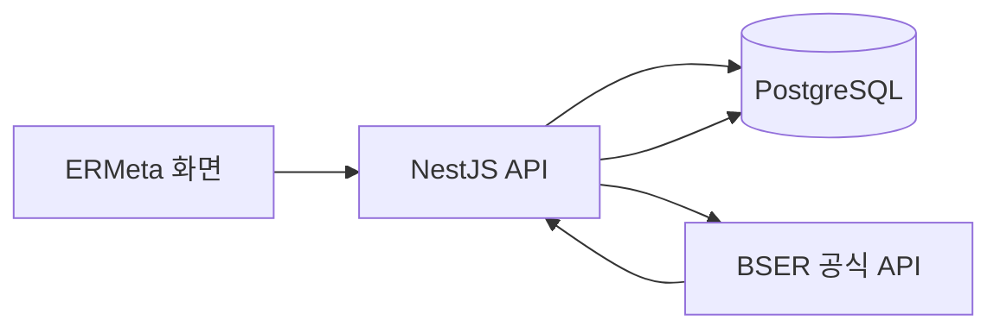

# 전적·통계 백엔드 설계

- 작성일: 2026-10-13
- 상태: 설계 초안 — 구현 전에 외부 API 응답과 미정 사항 확인 필요
- 목표: NestJS로 개발·운영한 뒤 동일한 API 계약을 유지하며 Spring Boot로 전환

## 1. 목표와 범위

로그인 없이 닉네임으로 플레이어의 전적과 통계를 조회하는 별도 백엔드를 만든다. 검색한 플레이어의 경기 데이터를 PostgreSQL에 저장하고, ERMeta 화면에 개인 전적·개인 통계·최대 3명 멀티서치를 제공한다.

구현과 함께 HTTP API, 데이터 모델링, SQL, 트랜잭션, 인덱스, 외부 API 장애 대응을 학습한다. Google Cloud 배포와 운영 결과, 이후 Spring 마이그레이션 과정을 포트폴리오로 정리한다.

### 첫 버전 기능

| 기능 | 제공할 내용 |
| --- | --- |
| 개인 전적 | 닉네임 검색, 최근 경기 목록, 페이지 단위 조회 |
| 공식 개인 통계 | 공식 API가 제공하는 시즌 성적과 실험체별 기록 |
| 저장 경기 통계 | DB에 저장한 경기로 계산한 개인 통계와 표본 정보 |
| 멀티서치 | 최대 3명의 성적 비교와 사용자별 조회 결과 |

첫 버전에서는 로그인·회원 관리, 전체 경기 상시 수집, 전체 실험체 메타 집계를 다루지 않는다. 수집 대상은 사용자가 검색한 플레이어다.

## 2. 구성과 역할

| 구성 | 역할 |
| --- | --- |
| BSER 공식 API | 플레이어 식별자, 경기 원본, 공식 시즌 통계 제공 |
| PostgreSQL | 조회 결과 저장, 중복 방지, 전적 조회, 저장 경기 통계 계산 |
| NestJS | 입력 검증, 외부 조회, 저장과 갱신 조정, 응답 가공 |
| ERMeta 화면 | 검색 입력, 전적·통계 표시, 갱신 시점과 오류 안내 |

API 키는 백엔드 환경변수로만 관리한다. 프론트엔드에 공식 API 키나 임시 UID를 전달할 필요는 없다. 기존 Next.js 서버 경로를 중계 경로로 사용할지는 화면 연동 단계에서 확정한다.

별도 캐시는 반복 조회 비용을 측정한 뒤 추가 여부를 결정한다. DB의 저장 데이터와 갱신 시점만으로 먼저 조회 흐름을 완성한다.

## 3. 데이터 모델

다음 네 테이블을 기본 모델로 사용한다. 필드와 자료형은 마이그레이션 작성 전에 실제 응답을 확인해 확정한다.

### player_lookups — 닉네임 조회 결과

| 필드 | 의미 |
| --- | --- |
| id | 내부 조회 대상 식별자, 기본키 |
| nickname | 공식 API에서 확인한 닉네임 |
| provider_uid | 공식 API가 제공한 임시 식별자 |
| resolved_at | 닉네임과 UID를 확인한 시점 |
| matches_synced_at | 경기 저장을 마지막으로 완료한 시점, 최초에는 NULL |

회원 테이블이 아니다. 임시 UID를 영구적인 계정 식별자로 취급하지 않는다. 닉네임 변경 전후의 사용자를 임의로 연결하지 않으며, 새 UID를 확인했을 때 기존 조회 결과를 보존·교체하는 규칙은 외부 API 동작을 확인한 뒤 결정한다. 닉네임 대소문자 처리와 유니크 제약도 이 규칙과 함께 확정한다.

### matches — 경기 공통 정보

| 필드 | 의미 |
| --- | --- |
| game_id | 공식 경기 식별자, 기본키 |
| season_id | 시즌 식별자 |
| matching_mode | 경기 모드 |
| matching_team_mode | 팀 모드 |
| started_at | 경기 시작 시각 |

### player_match_records — 플레이어별 경기 결과

| 필드 | 의미 |
| --- | --- |
| id | 내부 기록 식별자, 기본키 |
| player_lookup_id | player_lookups 외래키 |
| game_id | matches 외래키 |
| character_code | 실험체 코드 |
| weapon_code | 무기 코드 |
| rank | 경기 순위 |
| kills | 킬 수 |
| assists | 어시스트 수 |

`(player_lookup_id, game_id)`에 유니크 제약을 둔다. 같은 플레이어의 같은 경기를 반복 수집해도 기록이 중복되지 않도록 upsert한다. 저장된 레코드는 검색한 플레이어의 기록이며, 해당 경기의 모든 참가자를 저장했다는 의미가 아니다.

### player_season_stats — 공식 시즌 통계 스냅샷

| 필드 | 의미 |
| --- | --- |
| player_lookup_id | player_lookups 외래키 |
| season_id | 통계 대상 시즌 |
| matching_mode | 통계 대상 모드 |
| total_games | 공식 시즌 경기 수 |
| wins | 공식 시즌 승리 수 |
| average_rank | 공식 시즌 평균 순위 |
| fetched_at | 공식 통계를 받아 저장한 시점 |

`(player_lookup_id, season_id, matching_mode)`를 유니크 키로 사용한다. 공식 통계가 팀 모드별로 나뉜다면 키에 팀 모드도 포함한다. MMR, 순위, 실험체별 통계 등 추가 응답 필드와 실험체별 통계의 별도 테이블 여부는 실제 API 계약을 확인해 결정한다. 첫 버전은 최신 스냅샷을 관리한다.

### 제약과 인덱스

- 경기 기본키와 플레이어별 경기 유니크 제약으로 중복 저장을 방지한다.
- 전적은 경기 시작 시각 내림차순, 같은 시각에서는 경기 ID 내림차순으로 정렬한다.
- 플레이어별 기록 조회와 경기 시각 정렬에 필요한 인덱스는 실제 SQL의 실행 계획을 확인해 확정한다. 서로 다른 테이블의 필드를 하나의 인덱스로 묶을 수 있다는 가정은 하지 않는다.
- 내부 시간은 시간대를 포함해 저장하고, 화면에서 표시 시간대로 변환한다. 외부 응답에 시간대가 없다면 해석 규칙을 먼저 확인한다.

## 4. 조회와 갱신 흐름

1. 닉네임과 조회 옵션을 검증한다.
2. 저장된 닉네임 조회 결과와 데이터 갱신 시점을 확인한다.
3. 데이터가 충분히 최신이면 DB에서 조회해 응답한다.
4. 갱신이 필요하면 공식 API에서 닉네임과 최근 경기를 조회한다.
5. 외부 응답을 검증한 뒤 경기와 플레이어별 기록을 한 트랜잭션으로 저장한다.
6. 저장 성공과 함께 `matches_synced_at`을 갱신한다.
7. DB에 저장된 결과를 조회해 응답한다.

외부 API를 기다리는 동안 DB 트랜잭션을 열어 두지 않는다. 저장 실패 시 갱신 시점을 성공으로 기록하지 않는다. 전적과 공식 시즌 통계는 별도의 갱신 시점을 관리한다.

동일 플레이어의 동시 갱신 요청은 하나의 작업을 공유하도록 한다. 초기 단일 프로세스에서는 메모리로 조정할 수 있지만, 여러 인스턴스로 배포한다면 공유 저장소 기반 조정이 필요하다. DB 유니크 제약은 어떤 배포 방식에서도 유지한다.

공식 API의 페이지 구분과 조회 가능 기간을 확인하고, 첫 수집량과 이후 갱신 범위를 제한한다. 갱신 간격, 타임아웃, 재시도 횟수, 호출량 제한은 코드에 흩어 두지 않고 설정으로 관리한다.

## 5. API 계약 초안

| API | 역할 |
| --- | --- |
| GET /v1/players/{nickname}/matches?limit=20&cursor=… | 최근 전적 조회, 필요 시 갱신 |
| GET /v1/players/{nickname}/stats?seasonId=… | 공식 시즌 통계 조회 |
| POST /v1/players/{nickname}/refresh | 전적·공식 시즌 통계 갱신 요청 |
| POST /v1/players/compare | 닉네임 최대 3명 비교 |

닉네임은 URL에 넣을 때 인코딩한다. 목록 응답은 경기 목록, 다음 커서, `lastSyncedAt`, `isStale`을 포함한다. 커서는 정렬에 사용하는 경기 시각과 경기 ID를 기준으로 설계한다.

공통 오류 응답은 기계가 처리할 수 있는 `code`와 사용자용 `message`를 포함한다. HTTP 상태와 오류 코드의 정확한 목록은 구현 전에 확정한다.

| 상황 | 처리 원칙 |
| --- | --- |
| 잘못된 입력 | 400과 입력 오류 코드 |
| 사용자 없음 | 404와 사용자 없음 코드 |
| 사용자 존재, 경기 없음 | 200과 빈 경기 목록 |
| 외부 API 실패, 저장 데이터 있음 | 저장 데이터와 갱신 시점, isStale=true 반환 |
| 외부 API 실패, 저장 데이터 없음 | 외부 서비스 실패 오류 반환 |
| 요청 제한 초과 | 429, 재시도 가능 시점 안내 |
| 멀티서치 일부 실패 | 성공한 사용자 결과와 사용자별 실패 상태를 함께 반환 |

명시적인 갱신 요청이 실패한 경우에는 갱신 실패를 표시한다. 저장된 데이터를 제공할 수 있어도 갱신 자체가 성공했다고 응답하지 않는다. 초기 갱신을 동기 요청으로 처리할지, 작업을 등록하고 202로 응답할지는 호출 시간과 공식 API 제한을 확인해 결정한다.

## 6. 통계의 출처 구분

공식 시즌 통계와 저장 경기 통계를 섞지 않는다.

- **공식 시즌 통계:** 공식 API가 제공하는 시즌 전체 지표. `player_season_stats`에 저장하고 조회 시점을 표시한다.
- **저장 경기 통계:** `player_match_records`에서 계산한 지표. 계산에 사용한 경기 수, 기간, 시즌·모드 필터를 응답에 포함한다.

최근 경기 일부만 저장했다면 그 승률을 시즌 전체 승률로 표시하지 않는다. 저장 경기 통계용 별도 API와 집계 SQL은 기본 저장·조회 흐름을 완성한 뒤 확정한다.

## 7. NestJS 모듈 구조

| 모듈 | 책임 |
| --- | --- |
| PlayersModule | 닉네임 조회 결과 관리 |
| MatchesModule | 경기 저장과 전적 목록 조회 |
| StatsModule | 공식 통계 저장·조회, 저장 경기 통계 계산 |
| PlayerSyncModule | 외부 조회부터 저장·갱신 시점 기록까지 조정 |
| BserApiModule | 공식 API 호출, 응답 검증, 타임아웃, 요청 제한 |
| DatabaseModule | PostgreSQL 연결과 트랜잭션 지원 |

Controller는 HTTP 입력과 응답을 처리하고, Service는 조회·갱신 규칙을 담당한다. DB 접근과 외부 API 호출을 분리해 서비스 로직을 각각 테스트할 수 있게 한다. ORM 선택은 미정이다.

## 8. 구현 순서와 완료 기준

### 1단계: 한 명의 전적 저장·조회

- 테이블·제약·마이그레이션 작성
- 닉네임으로 공식 API 조회
- 경기와 플레이어 기록 저장
- DB에서 최근 전적을 페이지 단위로 반환
- 입력 오류, 중복 수집, 저장 실패 시 롤백, 갱신 시점 처리 검증

완료 기준: 같은 플레이어를 반복 조회해도 기록이 중복되지 않고, 저장한 전적을 정해진 순서로 조회할 수 있다. 외부 장애 시 저장 데이터 유무에 맞는 응답을 반환한다.

### 2단계: 개인 통계

공식 시즌 통계 저장·조회와 저장 경기 기준 집계를 구현한다. 빈 표본, 시즌·모드 필터, 통계 출처와 표본 수를 검증한다.

### 3단계: 멀티서치

단일 사용자 조회 로직을 재사용해 최대 3명을 비교한다. 중복 닉네임, 일부 실패, 동시 요청, 외부 호출량을 검증한다.

### 4단계: Google Cloud 배포

애플리케이션 실행 환경, PostgreSQL 운영 위치, 비밀값 관리, 로그, 배포 자동화를 결정한다. 인스턴스 수와 공식 API 호출 제한이 맞물리는 점을 검토한다. 구체적인 제품·요금·예산은 배포 설계 시 확인한다.

### 5단계: Spring Boot 전환

PostgreSQL과 HTTP API 계약을 유지하며 구현을 교체한다. 같은 요청에 대한 응답과 오류 규칙을 계약 테스트로 비교하고, 실제 측정한 응답 시간과 운영 차이를 기록한다.

## 9. 구현 전 확정할 사항

- 실제 UID 응답 형식, 닉네임 변경 시 식별자 처리와 조회 결과 수명
- 공식 최근 경기 API의 페이지 구분, 반환량, 조회 가능 기간
- PostgreSQL 신규 DB 또는 기존 DB의 별도 스키마 사용 여부
- DB 접근 라이브러리 또는 ORM
- 초기 수집량, 갱신 간격, 외부 API 호출 제한
- 동기 갱신과 비동기 작업 처리 중 첫 구현 방식
- 다중 인스턴스의 갱신 중복 방지 방식
- API 응답 필드, 오류 코드, 공식 실험체별 통계 저장 구조

## 10. 기존 구현과의 관계

기존 최근 전적 구현은 외부 API 조회와 캐시 중심의 초안이다. 본 설계의 PostgreSQL 저장·갱신 흐름을 구현한 것으로 간주하지 않는다. 기존 코드에서 재사용할 부분은 새 API 계약과 데이터 모델이 확정된 뒤 판단한다.

관련 작업: [이슈 #297](https://github.com/BellYun/ERMeta/issues/297), [PR #299](https://github.com/BellYun/ERMeta/pull/299).

## 11. 1단계 구현 결정 (#300)

- 기존 분석용 테이블과 분리하기 위해 `DATABASE_URL`이 가리키는 PostgreSQL의 `player_history` 스키마를 사용한다. DB 접근은 `pg`와 명시적 트랜잭션으로 구현했다. 마이그레이션은 수동 실행하며 애플리케이션 시작 시 자동 적용하지 않는다.
- 닉네임은 대소문자를 구분하지 않는 `nickname_key`로 조회한다. UID는 [공식 문서](https://developer.eternalreturn.io/static/media/OpenAPI_EN_20260917_01.html)의 임시 식별자다. 같은 닉네임에서 UID가 바뀌면 기존 플레이어별 경기 기록을 트랜잭션 안에서 제거하고 새 결과로 대체한다. 다른 닉네임 간 사용자를 자동 연결하지 않는다.
- 공식 문서는 최근 90일의 경기 목록을 설명하며 별도 페이지 매개변수는 없다. 2026-10-13 실측 요청에서는 10건이 왔고 응답 최대량은 아직 확정하지 않았다. 첫 구현은 시작 시각·경기 ID 순으로 정렬한 최대 300건을 저장한다. API 페이지네이션은 저장된 DB 기록을 대상으로 한다.
- 기본 갱신 간격은 300초(`PLAYER_MATCH_TTL_SECONDS`)다. 단일 프로세스 안의 같은 닉네임 동시 요청은 하나의 외부 조회를 공유한다. 여러 인스턴스의 중복 외부 호출 조정은 배포 단계에서 다룬다. DB 저장에는 닉네임별 트랜잭션 잠금과 유니크 제약을 적용했다.
- 2026-10-13 실 API 확인 결과 닉네임 조회 응답은 `userId`를, 경기 시작 시각은 `2026-10-12T20:16:08.008+0900`처럼 콜론 없는 UTC 오프셋을 사용했다. 문서의 `uid` 형식도 허용하고, 시간대 오프셋은 `+09:00` 형식으로 정규화해 저장한다. 시간대가 아예 없는 응답에만 `BSER_MATCH_TIME_OFFSET`(기본 `+09:00`)을 적용한다.
- `GET /v1/players/:nickname/matches`는 `matches`, `nextCursor`, `lastSyncedAt`, `isStale`을 반환한다. PostgreSQL `BIGINT` 정밀도 유지를 위해 `gameId`는 문자열이다. 커서는 플레이어 ID·경기 시각·경기 ID를 인코딩하며 다른 플레이어 요청에 재사용할 수 없다.
- 현재 단계의 빈 경기 목록은 정상 200 응답이다. 닉네임 없음은 404, 입력 오류는 400, 저장 데이터 없는 외부 장애는 502, 공식 API 429는 429다. 외부 장애 시 저장된 전적이 있으면 `isStale=true`로 제공한다.

## 12. 2단계 저장 경기 통계 결정 (#305)

- 공식 시즌 전체 통계(`/stats`)와 구분하기 위해 저장 경기 집계는 `GET /v1/players/:nickname/match-stats?seasonId=…&matchingMode=…`로 제공한다. `source=stored_matches`와 `sampleSize`, 표본 경기 기간을 응답에 포함한다.
- 새 저장 모델을 만들지 않고 `player_match_records`와 `matches`를 조인해 시즌·매칭 모드별로 집계한다. 이미 적용된 플레이어·경기 유니크 제약 덕분에 같은 경기를 반복 수집해도 표본이 중복되지 않는다.
- 전적 API의 닉네임 검증·갱신·장애 시 저장 데이터 사용 규칙을 재사용한다. 표본이 없더라도 유효한 플레이어라면 200과 0건을 반환하며, 평균과 표본 기간은 `null`이다.
- 저장된 최근 경기만 계산하므로 공식 시즌 전체 성적과 다를 수 있다. 승률은 0~100 퍼센트, 3위 이내 비율은 0~1 비율로 반환한다.

## 12. 2단계 1차 구현 결정 (#303)

- 공식 시즌 통계는 `player_history.player_season_stats`에 시즌·매칭 모드·팀 모드별 최신 스냅샷으로 저장한다. 주요 지표는 컬럼으로, API 응답에 필요한 정규화된 지표와 실험체별 기록은 JSONB로 보존한다.
- `GET /v1/players/:nickname/stats`는 필수 `seasonId`, `matchingMode`를 받아 공식 통계와 `source=bser_official`, `fetchedAt`, `isStale`을 반환한다. 랭크 전용 지표가 없으면 `null`이다. 빈 공식 통계는 정상 200의 `stats=null`이다.
- 기본 재조회 간격은 600초(`PLAYER_STATS_TTL_SECONDS`)다. 공식 API 장애 시 저장된 스냅샷만 오래된 데이터로 제공한다. 빈 결과는 저장하지 않는다.
- UID가 변경되면 같은 닉네임에 보관된 이전 UID의 전적과 시즌 통계를 모두 제거한다. 저장 경기 기준 집계는 2단계 후속 작업으로 남긴다.
